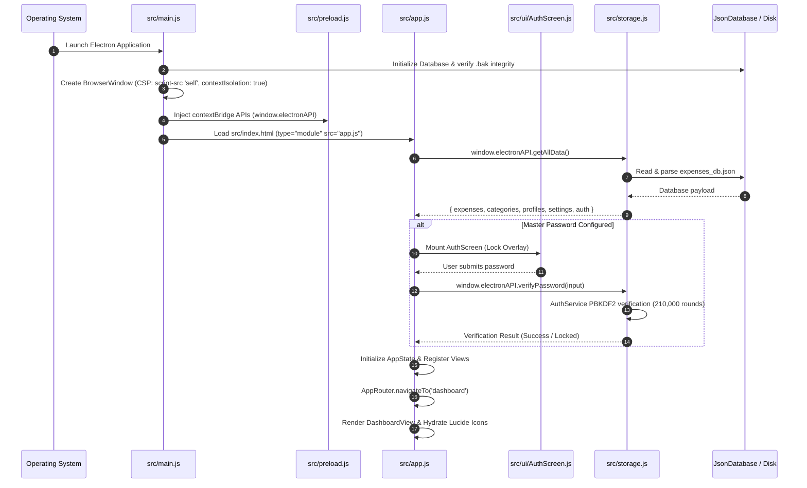
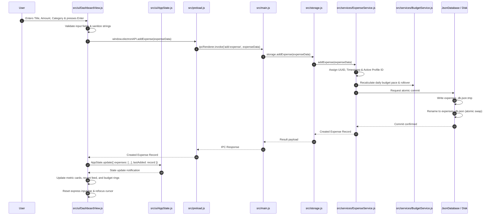

# 🔄 Ledgerly — System Architecture & Application Flow (`FLOW.md`)

> **Version Cycle**: `0.5` — *On-Device Machine Learning Document Intelligence & Multi-Tier Receipt Processing Engine*  
> **Current State**: `v0.5.3` (Phase 3: Tier 1 Fast-Lite Bundled Engine & Instant Receipt Autofill Complete)  
> **Preceding Version**: `0.4.7` (Major Restructuring & Enterprise Resilience Milestone)  
> **Status**: **ACTIVE & CANONICAL**  
> **Scope**: Complete end-to-end data lifecycle, component interaction, IPC contracts, state management, and ML document intelligence pipeline across Version 0.5 subsections (v0.5.1 to v0.5.7).

---

## 🧭 Executive Summary

In **Version 0.4**, Ledgerly underwent a complete architectural decomposition of both its backend and frontend monoliths. The monolithic 4,862-line `src/app.js` orchestrator was decomposed into 8 specialized view modules, 3 reusable UI components, and a dedicated router and reactive state container, reducing the root orchestrator down to 567 lines (**88.3% line reduction**). Concurrently, the backend data layer was dismantled from a monolithic storage file into 8 dedicated domain services under `src/services/`, preserved under an API Facade ensuring 100% backward compatibility.

All inline event attributes (`onclick=`, `onchange=`, `onsubmit=`) were stripped from HTML templates and replaced with semantic event delegation (`data-action="..."`, `data-tab="..."`), allowing the Content Security Policy (CSP) to be hardened to `script-src 'self'`.

---

## 🏛️ End-to-End System Architecture

```
+-----------------------------------------------------------------------------------------+
|                                    RENDERER PROCESS                                     |
|                                                                                         |
|   +---------------------------------------------------------------------------------+   |
|   |                              src/index.html                                     |   |
|   |  - Static Shell Layout       - Navigation Sidebar        - Modals Containers    |   |
|   |  - Hardened CSP (script-src 'self')                     - Native ES Module Entry |   |
|   +---------------------------------------+-----------------------------------------+   |
|                                           |                                             |
|                                           v                                             |
|   +---------------------------------------------------------------------------------+   |
|   |                                 src/app.js                                      |   |
|   |           Application Orchestrator & Bootstrapper (567 lines)                   |   |
|   |  - Wires event delegation    - Initializes Router       - Binds Global Hotkeys  |   |
|   +-------------------+---------------------------------------------+---------------+   |
|                       |                                             |                   |
|                       v                                             v                   |
|   +---------------------------------------+     +-----------------------------------+   |
|   |           src/ui/AppRouter.js         |     |        src/ui/AppState.js         |   |
|   |  - Tab Navigation Engine              |     |  - Centralized Reactive Store     |   |
|   |  - Route history & active classes     |     |  - Key-value state management     |   |
|   |  - Isolated try/catch view rendering  |     |  - Observer pattern subscriptions |   |
|   +-------------------+-------------------+     +-----------------+-----------------+   |
|                       |                                           |                     |
|                       v                                           |                     |
|   +-------------------------------------------------------------+ |                     |
|   |                    Modular View Controllers                 | |                     |
|   |  - DashboardView.js      - ExpenseFeedView.js               | |                     |
|   |  - HouseholdView.js      - BatchView.js                     | |                     |
|   |  - SettingsView.js       - NotesView.js                     | |                     |
|   |  - NotificationView.js   - ImportView.js                    | |                     |
|   +-------------------------------------------------------------+ |                     |
|   |                     Reusable UI Components                  | |                     |
|   |  - AuthScreen.js         - CommandPalette.js                | |                     |
|   |  - ChartManager.js       - quickPill.js                     | |                     |
|   +---------------------------------------+---------------------+ |                     |
|                                           |                       |                     |
|                                           | Dispatches User       | Reads/Updates State |
|                                           | Actions               |                     |
|                                           v                       v                     |
|   +---------------------------------------------------------------------------------+   |
|   |                       src/preload.js (Context Bridge)                           |   |
|   |  - Secure window.electronAPI method exposure via contextBridge.exposeInMainWorld|   |
|   |  - Strict boundary isolation (nodeIntegration: false, contextIsolation: true)  |   |
|   +---------------------------------------+-----------------------------------------+   |
+-------------------------------------------|---------------------------------------------+
                                            |
                                            | ipcRenderer.invoke(channel, ...args)
                                            v
+-----------------------------------------------------------------------------------------+
|                                      MAIN PROCESS                                       |
|                                                                                         |
|   +---------------------------------------------------------------------------------+   |
|   |                                  src/main.js                                    |   |
|   |  - Electron Lifecycle & BrowserWindow management                                |   |
|   |  - ipcMain.handle(...) dispatch router                                          |   |
|   |  - Native OS File Picker & Shell integrations                                   |   |
|   +---------------------------------------+-----------------------------------------+   |
|                                           |                                             |
|                                           v                                             |
|   +---------------------------------------------------------------------------------+   |
|   |                                src/storage.js                                   |   |
|   |                          Backwards-Compatible Facade                            |   |
|   |  - Delegates incoming calls to specialized domain services                      |   |
|   |  - Coordinates cross-domain multi-service transactions                          |   |
|   +---------------------------------------+-----------------------------------------+   |
|                                           |                                             |
|         +---------------------------------+---------------------------------+           |
|         |                                 |                                 |           |
|         v                                 v                                 v           |
| +--------------------+          +--------------------+            +-------------------+ |
| | src/services/      |          | src/services/      |            | src/services/     | |
| | AuthService.js     |          | ProfileService.js  |            | ExpenseService.js | |
| | - PBKDF2-SHA512    |          | - Profile CRUD     |            | - Transactions    | |
| | - Salt & Throttling|          | - Monograms        |            | - Presets & Search| |
| +--------------------+          +--------------------+            +-------------------+ |
|         |                                 |                                 |           |
|         v                                 v                                 v           |
| +--------------------+          +--------------------+            +-------------------+ |
| | src/services/      |          | src/services/      |            | src/services/     | |
| | BudgetService.js   |          | HouseholdService.js|            | NotesService.js   | |
| | - Salary Allocation|          | - Shared Splitting |            | - Scoped Memos    | |
| | - Pacing & Rollover|          | - Pairwise Netting |            | - Context Badges  | |
| +--------------------+          +--------------------+            +-------------------+ |
|         |                                 |                                 |           |
|         v                                 v                                 v           |
| +--------------------+          +--------------------+            +-------------------+ |
| | src/services/      |          | src/fileImporter.js|            |src/receiptStorage | |
| | NotificationEngine |          | - Multi-Format CSV/|            | - Image validation| |
| | - Bill & Overspend |          |   XLSX/OFX/PDF     |            | - Disk attachment | |
| +--------------------+          +--------------------+            +-------------------+ |
|                                           |                                             |
|                                           v                                             |
|   +---------------------------------------------------------------------------------+   |
|   |                        src/database/JsonDatabase.js                             |   |
|   |  - Atomic writes: write to .tmp -> flush -> fs.renameSync to target file        |   |
|   |  - Windows file-lock exponential backoff retries (EPERM / EBUSY)                |   |
|   |  - Corrupt JSON self-healing via automated rotating .bak recovery              |   |
|   +---------------------------------------+-----------------------------------------+   |
+-------------------------------------------|---------------------------------------------+
                                            |
                                            | Atomic File I/O
                                            v
+-----------------------------------------------------------------------------------------+
|                                    PHYSICAL DISK                                        |
|                                                                                         |
|   - %APPDATA%/Ledgerly/expenses_db.json (Active Database)                               |
|   - %APPDATA%/Ledgerly/expenses_db.json.bak (Automated Backup)                          |
|   - %APPDATA%/Ledgerly/receipts/* (Local Receipt Image Files)                           |
+-----------------------------------------------------------------------------------------+
```

---

## 🔄 Core Operational Lifecycles

### 1. Application Boot & Authentication Lifecycle



### 2. Transaction Ingestion Lifecycle (Express Bar & Preset Chips)



### 3. Tab Routing & View Rendering Boundary

Every view switch flows through `src/ui/AppRouter.js` using an isolated `try/catch` boundary:

```javascript
// AppRouter.js rendering isolation pattern:
try {
  view.render(viewContainer, appState.getState());
  hydrateIcons();
  this.dispatchRouteChange(targetTabId);
} catch (error) {
  console.error(`[AppRouter] Error rendering view ${targetTabId}:`, error);
  viewContainer.innerHTML = `
    <div class="view-error-card">
      <h3>Failed to load ${targetTabId}</h3>
      <p>${error.message}</p>
      <button data-action="reload-tab" data-tab="${targetTabId}">Retry</button>
    </div>
  `;
}
```

---

## 🔒 Security & Content Security Policy (CSP) Flow

```
[Old Architecture (v0.3 and below)]
  HTML Template Literal: `<button onclick="editExpense('${id}')">Edit</button>`
  Requirement: Content-Security-Policy: script-src 'self' 'unsafe-inline';
  Risk: Inline script injection, XSS vulnerability surface.

[New Architecture (v0.4)]
  HTML Template Literal: `<button class="btn" data-action="edit-expense" data-id="${id}">Edit</button>`
  Event Delegation: Container listens for clicks -> reads e.target.closest('[data-action]') -> dispatches handler
  Requirement: Content-Security-Policy: script-src 'self';
  Result: 100% elimination of 'unsafe-inline', rigorous DOM security isolation.
```

---

## 🛡️ Multi-Phase Error Handling & Resilience Architecture

The application implements a multi-tier resilience strategy distributed across current safeguards and upcoming hardening phases:

```
+-----------------------------------------------------------------------------------------+
|                                RESILIENCE & ERROR ROADMAP                               |
+-----------------------------------------------------------------------------------------+
| [CURRENT BASELINE - v0.4]                                                               |
| - Atomic Disk Writes (tmp -> rename) in JsonDatabase                                    |
| - Exponential Backoff Retries on Windows file locks (EPERM / EBUSY)                     |
| - Corrupt Database Recovery via automated .bak file fallback                            |
| - PBKDF2-SHA512 Cryptographic Timing-Safe Password Verification & 30s Lockout          |
| - CSV / Excel Formula Injection Sanitization (=, +, -, @) in fileImporter               |
| - Isolated View try/catch Rendering Boundaries in AppRouter                             |
| - Headless SSR Guards (typeof document === 'undefined') across all UI modules           |
+-----------------------------------------------------------------------------------------+
                                            |
                                            v
+-----------------------------------------------------------------------------------------+
| [PHASE 5: IPC RUNTIME SCHEMA VALIDATION & ERROR CONTRACT STANDARDIZATION - COMPLETE]   |
| - Zero-dependency runtime schema validator (src/validation/schemaValidator.js)          |
| - Boundary guard wrapIPC middleware intercepting all ipcMain.handle channels            |
| - Standardized envelope: { success, data, error, code, details } across all wire calls   |
| - Dual array and envelope compatibility wrapper in src/preload.js (invokeIPC)           |
| - 39/39 automated positive, negative, and boundary tests passing in scratch/            |
+-----------------------------------------------------------------------------------------+
                                            |
                                            v
+-----------------------------------------------------------------------------------------+
| [PHASE 6: GLOBAL UI ERROR BOUNDARIES, CRASH TRAPS & AUDIT REMEDIATION - COMPLETE]       |
| - UI Error Boundary: ErrorBoundary.js with isolated section degradation fallback cards  |
| - Recovery actions: Retry Section, Return to Dashboard, Copy Diagnostics                |
| - Global renderer traps: setupGlobalErrorTraps() for window.onerror & unhandledrejection|
| - Main process crash traps: uncaughtException, unhandledRejection, render-process-gone  |
| - Persistent file crash logger: crashLogger.js with 5MB rotation (crash.log)           |
| - Universal importer safeguards: 50MB file size limit, 25k row capping, truncate alert  |
| - Remediated QA audit defects: BUG-001 (decimals), BUG-002 (DB env), BUG-003, BUG-004   |
| - 11/11 automated resilience unit & stress tests passing in scratch/                    |
+-----------------------------------------------------------------------------------------+
                                            |
                                            v
+-----------------------------------------------------------------------------------------+
| [PHASE 7: ENTERPRISE RESILIENCE, OFFLINE SYNC CONFLICTS & ADVANCED TELEMETRY - COMPLETE] |
| - Self-Healing Startup Database Auditor: DatabaseAuditor.js with .pre-audit.bak snapshot |
| - Privacy-Sanitized Offline Telemetry: DiagnosticExporter.js with path & token masking    |
| - Deterministic Offline Sync Engine: SyncEngine.js (vector clocks, LWW, 3-way merge)       |
| - Bounded 10-Item Undo Stack: AppState.js with global Ctrl+Z and action toasts            |
| - Express Import Reconciliation: Fuzzy duplicate detection (₹0.01 / ±2 days) & skip toggle|
| - Proactive Recurring Bill Due Banner: 1-click execution on Dashboard cockpit             |
| - Spotlight Zero-Eval Calculator: safeEvaluateMath() Shunting-Yard parser & notes search   |
| - 12/12 automated resilience unit tests passing in scratch/test_phase7_resilience.js      |
+-----------------------------------------------------------------------------------------+
                                            |
                                            v
+-----------------------------------------------------------------------------------------+
| [PHASE 0.5.2: DOCUMENT NORMALIZATION & IMAGE PREPROCESSING ENGINE - COMPLETE]           |
| - Magic byte sniffing (PDF, JPEG, PNG, WebP, BMP, TIFF)                                 |
| - Adaptive 1200-2400px detail density scaling based on Laplacian edge transitions       |
| - Early blur rejection gate (Laplacian variance < 32.0 -> ERR_IMAGE_BLURRY)             |
| - Adaptive thermal receipt contrast booster (P5/P95 histogram stretching)               |
| - Digital vector PDF fast-path (<10ms Flate decompression) + multi-page selection        |
| - Encrypted PDF trap (ERR_PDF_ENCRYPTED) & zero-native build tool guarantee             |
+-----------------------------------------------------------------------------------------+
                                            |
                                            v
+-----------------------------------------------------------------------------------------+
| [PHASE 0.5.3: TIER 1 FAST-LITE RECEIPT ENGINE & INSTANT AUTOFILL - COMPLETE]            |
| - Bundled offline Tesseract WASM OCR (assets/models/tesseract/eng.traineddata, 5.19MB)   |
| - Reverse bottom-to-top token attention parser for grand totals & merchant resolution   |
| - Indian GSTIN (15-char) & tax split (CGST/SGST/IGST) + UPI payment slip extraction     |
| - Multi-currency support (INR ₹, USD $, EUR €, GBP £) & ISO date normalization           |
| - 0% false-positive financial intent rejection gate (9/9 negative controls cleanly rejected)|
| - Smart non-destructive autofill in ExpenseFeedView modal & QuickPill drag-and-drop     |
| - 50/50 automated test assertions passing in scratch/test_receipt_tier1.js              |
+-----------------------------------------------------------------------------------------+
```

---

## 📊 Version Milestone Lineage

> [!NOTE]
> **Versioning Taxonomy**:
> - The leading **`0`** denotes that Ledgerly is currently within its **Alpha Build Phase** (`0.x.x`) of active architecture and feature building. The official **`v1.0.0`** release will mark the production-ready build for user download and deployment.
> - The version **`0.4`** represents the **overall phase structure** (*Major Codebase Restructuring Improving Its Readability*).
> - Each phase represents a specific **subsection of version 0.4** (`0.4.1` through `0.4.7`).
> - The version **`0.5`** represents the **on-device machine learning document intelligence cycle** (`0.5.1` through `0.5.7`).

| Version / Sub-version | Milestone / Phase Name | Key Architectural Shift |
|---|---|---|
| **v0.1.0** | Desktop Core Foundation | Offline Electron runtime, local JSON db, express bar, presets, batch mode, salary pace & rollover, local receipts |
| **v0.2.0** | Visual Design Language System | Theme 3 (Graphite & Spiced Chai Amber), Inter & JetBrains Mono fonts, 93 Lucide SVG icons, monogram avatars, offline Chart.js |
| **v0.3.0** | Ambient Intelligence & Polish | Multi-profile switcher, universal statement importer (CSV/XLSX/OFX/PDF), contextual notes, pairwise debt netting, quick-add pill widget |
| **v0.4** | **Major Restructuring of the Code Improving Its Readability** | **Complete dual-monolith decomposition, IPC boundary guard & enterprise resilience** |
| ↳ **v0.4.1** (Phase 1) | Security Hardening Baseline | CSP baseline, PBKDF2 (210K rounds), formula sanitization |
| ↳ **v0.4.2** (Phase 2) | Tooling, Type Contracts & Constants | ESLint, Prettier, JSDoc `types.js`, frozen constants |
| ↳ **v0.4.3** (Phase 3) | Backend Domain Service Decomposition | 8 domain services (`src/services/`), backward-compatible facade |
| ↳ **v0.4.4** (Phase 4) | Frontend Modular UI Decomposition | 8 views, 3 components (`src/ui/`), ES modules, zero inline events (88.3% line reduction) |
| ↳ **v0.4.5** (Phase 5) | IPC Runtime Schema Validation Layer | Boundary schema validation in `main.js`, standardized `{ success, data, error }` envelopes |
| ↳ **v0.4.6** (Phase 6) | Global UI Error Boundaries, Crash Traps & Audit Remediation | `ErrorBoundary.js`, section fallback cards, `crashLogger.js` (5MB rotation), uncaughtException/unhandledRejection traps, importer safeguards, resolved BUG-001..004 |
| ↳ **v0.4.7** (Phase 7) | Enterprise Resilience, Offline Sync & Diagnostics | DatabaseAuditor self-healing, DiagnosticExporter telemetry, SyncEngine 3-way merge, Ctrl+Z undo, fuzzy deduplication (Concludes Version 0.4) |
| **v0.5** | **On-Device Machine Learning Document Intelligence & Multi-Tier Receipt Processing Engine** | **Local, zero-cloud ML models for camera photos, PDF statements, and receipts** |
| ↳ **v0.5.1** (Phase 1) | Dataset Sourcing & Base Model Discovery | Standardized schema (SROIE, CORD, Indian GST & UPI), 54-sample negative control gate, 3-tier model profiling |
| ↳ **v0.5.2** (Phase 2) | Document Normalization & Image Preprocessing | Magic byte sniffing, EXIF rotation, adaptive 1200-2400px density scaling, blur rejection gate, thermal contrast boosting, vector PDF fast-path (<10ms) |
| ↳ **v0.5.3** (Phase 3) | Tier 1 (Fast-Lite) Bundled Engine & Instant Receipt Autofill | Offline Tesseract WASM (5.19MB), reverse token attention, smart non-destructive autofill, UPI & GST breakdown, negative transaction gate |
| **v1.0.0** | **Official Production Release** | Production-ready deployment for user download |
