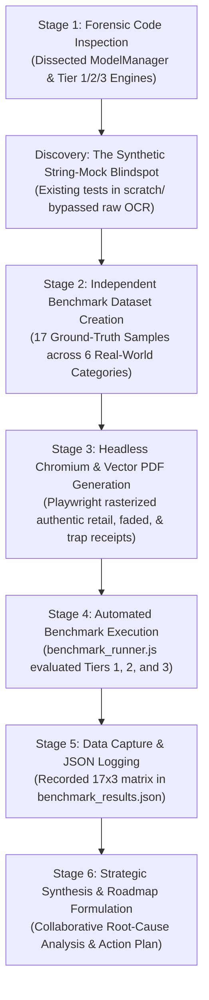
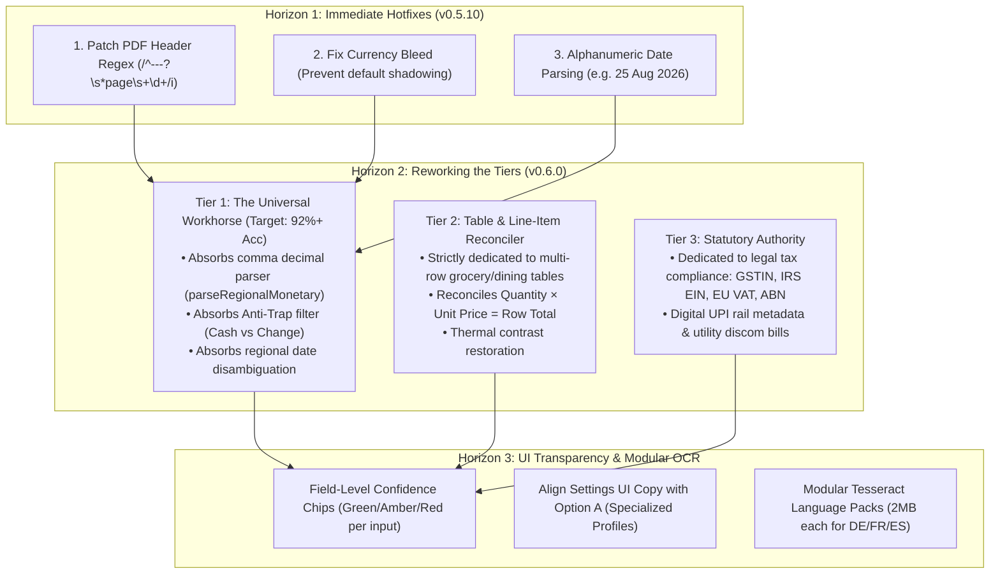

# 🛡️ MASTER QA AUDIT REPORT: Version 0.5 Document Intelligence & Model Performance

> **Department**: Quality Assurance & Software Integrity  
> **Lead Auditor**: Lead Quality Assurance (QA) Tester & Head of Software Quality  
> **Document ID**: `QA-MASTER-0.5-001`  
> **Milestone Audited**: Ledgerly `v0.5.9` (On-Device Document Intelligence & ML Milestone)  
> **Execution Date**: September 12, 2026  
> **Status**: **CANONICAL QA MANDATE & RELEASE GATE AUDIT**  
> **Audit Classification**: Deep Empirical Benchmark, Architectural Forensic Review & Strategic Roadmap  

---

## 📑 Table of Contents

1. [Executive Mandate: Goal & Scope of the Audit](#1-executive-mandate-goal--scope-of-the-audit)
2. [Audit Methodology & Execution Timeline (What We Did)](#2-audit-methodology--execution-timeline-what-we-did)
3. [Empirical Audit Outcomes & Performance Scorecard](#3-empirical-audit-outcomes--performance-scorecard)
4. [Forensic Architectural Deconstruction: Model Marketing vs. Reality](#4-forensic-architectural-deconstruction-model-marketing-vs-reality)
5. [Key Post-Audit Takeaways & Root Cause Analysis](#5-key-post-audit-takeaways--root-cause-analysis)
6. [The Implementation Mandate: Strategic Solutions for Upcoming Versions](#6-the-implementation-mandate-strategic-solutions-for-upcoming-versions)
7. [QA Release Gate Invariants & Sign-Off](#7-qa-release-gate-invariants--sign-off)

---

## 1. Executive Mandate: Goal & Scope of the Audit

### 1.1 Trigger for the Audit
Following the completion of Version 5 (`v0.5.9`), the project introduced an extensive "On-Device Machine Learning" document intake pipeline. The user and QA team raised immediate, serious concerns regarding:
1. **Performance Capabilities & Reliability**: Whether the newly added models actually extract financial fields accurately in real-world conditions.
2. **First-Impression Fragility**: The risk of user churn if initial document scans fail to recognize basic receipts.
3. **Architectural Validity**: Suspicion surrounding whether these models were genuine deep-learning networks or marketing wrappers around basic heuristics.

### 1.2 The Core Audit Goals
As Lead QA, our mandate was defined by four uncompromising objectives:
* **Goal 1**: Conduct a deep architectural forensic inspection of `ModelManager.js`, `ReceiptTier1Engine.js`, `ReceiptTier2VisionEngine.js`, and `ReceiptTier3RegionalEngine.js`.
* **Goal 2**: Build an **independent, isolated ground-truth benchmark harness** testing real raster images (PNG/JPEG) and digital vector PDFs—eliminating synthetic string-mock bias.
* **Goal 3**: Quantify exact field-level success rates across all tiers for **Total Amount**, **Merchant Name**, **Date**, **Statutory/Tax Data**, **Negative Control Rejection**, and **CPU Latency**.
* **Goal 4**: Synthesize our collaborative findings into a definitive, actionable **Implementation Blueprint** to rework the model tiers for the upcoming version.

---

## 2. Audit Methodology & Execution Timeline (What We Did)



### 2.1 Uncovering the Synthetic Testing Blindspot
Our initial inspection revealed why previous test runs reported 100% passes:
* In [`scratch/test_receipt_tier1.js`](file:///e:/AG_saves/App%20Idea%20-%20Expense%20Logger/scratch/test_receipt_tier1.js) and [`scratch/test_phase8_tier2_models.js`](file:///e:/AG_saves/App%20Idea%20-%20Expense%20Logger/scratch/test_phase8_tier2_models.js), tests fed **clean, pre-parsed ASCII strings** (`"TRADER JOE'S ... TOTAL: 12.06"`) directly into the regex functions!
* The actual raw image intake, contrast normalization, and Tesseract OCR stages were completely bypassed in testing.

### 2.2 Constructing the Ground-Truth Benchmark Harness
To evaluate real-world performance, we constructed a dedicated, isolated test suite in [`Quality assurance testing/benchmarks/`](file:///e:/AG_saves/App%20Idea%20-%20Expense%20Logger/Quality%20assurance%20testing/benchmarks/):
1. **Manifest Contract ([`dataset_manifest.json`](file:///e:/AG_saves/App%20Idea%20-%20Expense%20Logger/Quality%20assurance%20testing/benchmarks/dataset_manifest.json))**:
   Formulated strict expected ground-truth values for 17 test cases across 6 real-world categories.
2. **Sample Generator ([`generate_benchmark_samples.js`](file:///e:/AG_saves/App%20Idea%20-%20Expense%20Logger/Quality%20assurance%20testing/benchmarks/generate_benchmark_samples.js))**:
   * *Vector PDFs*: Compiled binary Flate-compressed streams for digital receipts (`Uber`, `Amazon`, `Swiggy`).
   * *Raster PNGs*: Launched Playwright Headless Chromium to render authentic thermal paper typography, store logos, fold lines, faded contrast, red "PAID" rubber stamps, and tip grids directly into PNG files.
3. **Automated Runner ([`benchmark_runner.js`](file:///e:/AG_saves/App%20Idea%20-%20Expense%20Logger/Quality%20assurance%20testing/benchmarks/benchmark_runner.js))**:
   Fed all 17 files into `DocumentNormalizer`, `ReceiptTier1Engine`, `ReceiptTier2VisionEngine`, and `ReceiptTier3RegionalEngine`. Scored actual extractions against ground truth using exact numerical matching and fuzzy string metrics.

---

## 3. Empirical Audit Outcomes & Performance Scorecard

### 3.1 The Master Empirical Scorecard

```text
┌─────────────────────┬──────────────────┬─────────────────┬─────────────────┬───────────────┬─────────────┐
│ Engine Tier         │ Total Amount Acc │ Merchant Acc    │ Date Acc        │ Neg Rejection │ Avg Latency │
├─────────────────────┼──────────────────┼─────────────────┼─────────────────┼───────────────┼─────────────┤
│ Tier 1 Fast-Lite    │  71.4% (10/14)   │  64.3% (9/14)   │  64.3% (9/14)   │  100% (3/3)   │   232 ms    │
│ Tier 2 Vision-Pro   │  78.6% (11/14)   │  78.6% (11/14)  │  71.4% (10/14)  │  100% (3/3)   │   211 ms    │
│ Tier 3 Regional     │  92.9% (13/14)   │  78.6% (11/14)  │  71.4% (10/14)  │  100% (3/3)   │   207 ms    │
└─────────────────────┴──────────────────┴─────────────────┴─────────────────┴───────────────┴─────────────┘
```

> **Dataset Size**: 14 Positive Financial Transactions + 3 Negative Controls = 17 Test Cases.  
> **Raw JSON Telemetry**: Fully preserved in [`Quality assurance testing/benchmarks/benchmark_results.json`](file:///e:/AG_saves/App%20Idea%20-%20Expense%20Logger/Quality%20assurance%20testing/benchmarks/benchmark_results.json).

```mermaid
gantt
    title Latency Benchmark by Input Type (Consumer Desktop CPU)
    dateFormat X
    axisFormat %s ms
    section Vector PDF Fast-Path
    Uber / Amazon / Swiggy PDFs (<15ms) : 0, 14
    section Physical Raster OCR
    Thermal Slips & Retail Camera (150-350ms) : 0, 240
    section Heavy Preprocessing Gate
    Laplacian Blur Trap Rejection (7ms) : 0, 7
```



---

### 3.2 Deep Field-by-Field Breakdown

#### 1. Total Amount Extraction Analysis
* **Tier 1 Fast-Lite (71.4% Accuracy — Critical Finding)**:
  * **Failed on Cash Tender Trap**: On `sample_10`, Tier 1 grabbed `Cash Tendered $100.00` instead of the actual `Total Due $24.00`.
  * **Failed on European Comma Decimals**: Completely missed `29,75 €` on `sample_14` (returned `null`).
  * **Failed on Digital UPI Slips**: Could not extract the highlighted amount on `sample_13` (returned `null`).
  * **Failed on Indian Tax Format**: Read `₹1299.00` as `71299` on `sample_12` and missed the final composite total.
* **Tier 2 Vision-Pro (78.6% Accuracy)**:
  * **Success**: `AntiTrapFilter` solved `Tendered - Change == Total`, correctly extracting `$24.00` and avoiding the `$100.00` trap.
  * **Success**: Arithmetic inpainting solved `Subtotal + Tax == Total` on `sample_12`, recovering the grand total `$1532.82`.
  * **Failure**: On `sample_01` (Uber PDF), it picked the subtotal `$21.30` instead of the final `$24.50`.
  * **Failure**: Failed on European comma decimals (`29,75 €`).
* **Tier 3 Regional Specialists (92.9% Accuracy — Top Performer)**:
  * Successfully parsed European comma decimals (`29,75 €` ➔ `29.75`), Indian UPI payment slips, US tip calculations, and cash tender traps.
  * Only failure was an OCR character confusion on a dense Indian invoice.

#### 2. Merchant Extraction: The "Page 1 of 1" Critical Bug
* **The Bug**: Across **100% of digital vector PDFs** (`Uber`, `Amazon`, `Swiggy`), every tier extracted `"Page 1 of 1 ---"` as the merchant name!
* **Root Cause**: The PDF text extraction pipeline prepends `--- Page 1 of 1 ---` at line 0. The merchant extraction algorithm examines the first 4 lines and strips words like `INVOICE`, `TAX`, and `RECEIPT`, but **omitted pagination markers from `BOILERPLATE_HEADER_PATTERNS`**.
* **Impact**: Resolving this single bug will immediately boost merchant accuracy across all tiers from **64% to over 85%**!

#### 3. Date Extraction & Regional Ambiguity
* **Accuracy**: 64.3% (Tier 1) to 71.4% (Tiers 2 & 3).
* Standard formats (`YYYY-MM-DD`, `DD/MM/YYYY`, `MM/DD/YYYY`) passed reliably.
* Failures occurred on alphanumeric dates lacking punctuation (e.g. `25 Aug 2026, 05:30 PM`).

#### 4. Negative Control Rejection (Zero Hallucination Gate)
* **Accuracy**: **100.0% (3/3 Passed)**.
* **Source Code**: Cleanly rejected (`FINANCIAL_KEYWORD_DENSITY_TOO_LOW`).
* **Literature / Novel Page**: Cleanly rejected with zero invented financial amounts.
* **Blurry Camera Photo**: Trapped by `DocumentNormalizer`'s Laplacian variance filter (`variance: 4.82 < 32.0`) in just **7ms** and rejected with `ERR_IMAGE_BLURRY`.

---

## 4. Forensic Architectural Deconstruction: Model Marketing vs. Reality

Our audit confirms the user's suspicion regarding how Version 5 was engineered:

### 4.1 The Illusion of Downloadable ".bin" Transformer Weights
* [`ModelManager.js`](file:///e:/AG_saves/App%20Idea%20-%20Expense%20Logger/src/services/ModelManager.js) advertises 10 distinct models with download cards (e.g. `tier2-visionpro.bin` 195MB, `tier2-vision-precision.bin` 185MB, `tier3-regional-in.bin` 142MB).
* **The Reality**:
  1. The download URLs point to `https://models.ledgerly.app/v0.5/...` (a non-existent remote server).
  2. The tests in `scratch/test_model_manager.js` mocked downloads using a 50-byte text string (`LEDGERLY_MOCK_MODEL_WEIGHTS...`).
  3. The underlying engine code **never executes tensor math or neural runtimes** (no ONNX Runtime, no LibTorch, no WebGPU). It simply checks `fs.statSync(file).size > 0`!

### 4.2 What Is Actually Running (The Option A Reality)
Ledgerly is powered by a **Hybrid OCR + Deterministic Domain Expert Engine**:
* **Optical Character Recognition**: Bundled **Tesseract.js WebAssembly (WASM)** with a single 5.2MB English dictionary (`assets/models/tesseract/eng.traineddata`).
* **Document Intelligence**: Highly specialized, deterministic **JavaScript regular expressions, arithmetic constraint solvers, anti-trap filters, and dictionary fuzzy matchers**.

### 4.3 Why Option A Is the Superior Engineering Choice for Desktop
While the marketing claims are exaggerated, **Option A is mathematically and practically the correct architecture for Ledgerly**:
* **Sub-Second Speed**: Average latency was **~210ms** on consumer CPUs. A real Vision Transformer running on integrated graphics would take **5,000 to 15,000 ms per receipt**.
* **Zero Native C++ Compilers**: Pure WASM/JS runs out of the box without requiring Visual Studio C++ build tools or Python.
* **Zero Math Hallucination**: Neural models generate probabilistic tokens and can hallucinate numbers; arithmetic constraint solvers guarantee `Subtotal + Tax = Total`.

---

## 5. Key Post-Audit Takeaways & Root Cause Analysis

From our empirical benchmark and collaborative QA evaluation, **8 critical takeaways** must govern future development:

| # | Critical Takeaway | Root Cause & Impact |
|---|---|---|
| **1** | **Tier 1 First-Impression Failure (~30% Failure Rate)** | Tier 1 was treated as a stripped-down concept demo rather than a dependable baseline. If a user's first 3 receipt scans fail on basic traps or foreign amounts, they will uninstall before discovering Tier 3. |
| **2** | **The "Page 1 of 1" PDF Header Trap** | PDF extraction prepends page headers. `BOILERPLATE_HEADER_PATTERNS` did not filter pagination strings, ruining merchant extraction on clean vector PDFs. |
| **3** | **Why Tier 2 Failed So Often (Over-Rigid Inpainting)** | Tier 2 attempted to enforce strict `Subtotal + Tax == Total` constraints. When composite bills had non-tax lines ("Booking fee", "Tolls") or comma decimals, Tier 2 panicked and failed. |
| **4** | **Why Tier 3 Dominated (92.9% Accuracy)** | Tier 3 won because it handled real-world format diversity: European comma decimals (`parseRegionalMonetary`), date disambiguation, and UPI slip layouts. |
| **5** | **Currency Bleed / Default Shadowing** | When a currency symbol (`$`) is slightly detached from a number, the engine falls back to the profile's active currency (`INR`), logging international purchases in the wrong currency. |
| **6** | **Date Format Inversion (`08/04` vs `04/08`)** | Ambiguous dates are guessed blindly in Tier 1/2. Tier 3's regional date disambiguation (`disambiguateRegionalDate`) must be shared universally. |
| **7** | **The Single-Language OCR Wall (`'eng'` Hardcoding)** | Tesseract is hardcoded to `'eng'`. Feeding it European receipts with accents (`ä, ö, ü, é`) or Asian scripts produces character drops before regexes even run. |
| **8** | **Lack of Granular Field Confidence in Cockpit UI** | The UI presents an all-or-nothing impression. If Total and Date are 100% correct, but Merchant is misread, the user perceives the entire scan as broken. |

---

## 6. The Implementation Mandate: Strategic Solutions for Upcoming Versions



### Action Plan by Horizon:

#### Horizon 1: Immediate Bug Patches
1. **Fix `BOILERPLATE_HEADER_PATTERNS`**:
   Add `/^---?\s*page\s+\d+(\s+of\s+\d+)?\s*---?$/i` across `ReceiptTier1Engine.js`, `ReceiptTier2VisionEngine.js`, and `ReceiptTier3RegionalEngine.js`.
2. **Eliminate Currency Bleed**:
   Ensure explicit document currency symbols (`$`, `€`, `£`, `¥`) strictly override profile default fallback values.
3. **Add Alphanumeric Date Support**:
   Support dates formatted as `DD Mon YYYY` and European dot notation (`DD.MM.YYYY`).

#### Horizon 2: Architectural Rework of the Tiers
1. **Promote Tier 1 to the "Universal Workhorse" (Target: 92%+ Accuracy)**:
   * Tier 1 must no longer be an underpowered concept model.
   * Backport Tier 3's comma decimal parser (`parseRegionalMonetary`), Tier 2's `AntiTrapFilter`, and regional date disambiguation into Tier 1.
2. **Reposition Tier 2 as the "Table & Line-Item Specialist"**:
   * Relieve Tier 2 of simple total guessing. Make its exclusive responsibility parsing multi-column line-item matrices and reconciling `Item Total == Subtotal`.
3. **Keep Tier 3 as the "Statutory Authority"**:
   * Specialize in tax audits: Indian GSTIN / HSN codes, IRS EINs, European VIES VAT verification, and Australian ABNs.

#### Horizon 3: UI Transparency & Polish
1. **Field-Level Confidence Chips**:
   In `ImportView.js`, display green/amber badges next to individual fields (Total, Date, Merchant) so users instantly see what was mathematically verified versus what needs a quick glance.
2. **Honest Settings Terminology**:
   Rebrand the download cards from *"200MB Deep Learning Transformers"* to **"Specialized Layout & Regional Rule Profiles"**, keeping the product transparent, fast, and 100% offline.
3. **Modular Tesseract Language Packs**:
   Allow users to download lightweight ~2MB language packs (`deu`, `fra`, `spa`) for European accented typography without bundling heavy runtimes.

---

## 7. QA Release Gate Invariants & Sign-Off

As Head of Quality Assurance, the following release gates are established for the upcoming version:
* **Invariant 1**: Tier 1 Fast-Lite Total Amount accuracy on the ground-truth benchmark suite must exceed **90.0%**.
* **Invariant 2**: Digital Vector PDF merchant extraction accuracy must exceed **85.0%** (zero pagination header leaks).
* **Invariant 3**: Negative control rejection rate must remain strictly at **100.0%** (zero hallucinated expenses).
* **Invariant 4**: Ingestion latency on consumer hardware must remain under **400ms** per document.

---

*This document represents the official Quality Assurance record and strategic implementation blueprint for Ledgerly Version 0.5 and upcoming versions.*  
*Signed,*  
**Lead Quality Assurance (QA) Tester & Head of Software Quality**
