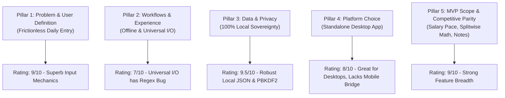

# 📋 Project Purpose & Vision Audit

> **Module**: Quality Assurance — Strategic Audit  
> **Document ID**: `AUD-001`  
> **Target**: Ledgerly Desktop Architecture & Product Scope  
> **Status**: Completed & Verified  

---

## 1. Executive Purpose Definition

The primary purpose of **Ledgerly** is to provide a **friction-free, 100% offline desktop financial control center for daily budget tracking and shared household spending**.

Historically, personal finance software forces users into an uncomfortable dilemma:
1. **The Cloud Surveillance Model (e.g., YNAB, Monarch, Copilot, Splitwise)**:
   - High subscription fees ($10–$15/month or $100+/year).
   - Mandatory bank linking (Plaid, Yodlee) exposing financial credentials to third parties.
   - Cloud storage exposing household spending habits to data breaches or monetized telemetry.
   - Feature bloat and upselling.
2. **The High-Friction DIY Model (e.g., Spreadsheets, Notion Templates)**:
   - Steep setup learning curves.
   - Formulas break easily.
   - High data-entry fatigue; manual date entry, category matching, and math on every receipt.
   - Users typically abandon them within two weeks.

**Ledgerly establishes a third category**: **The Private Sovereign Terminal**.
It provides the speed and auto-intelligence of modern web apps, combined with the absolute security, zero setup fatigue, and permanent ownership of local file-based storage.

---

## 2. Audit of the 5 Foundational Pillars

Based on the canonical project specification (`.gsd/SPEC.md`), here is the QA assessment of each pillar:

### Pillar 1: Problem & User Definition (Friction-Free Daily Entry)
* **Goal**: Solve the "data entry chore" so users can log an expense in under 5 seconds.
* **QA Audit**:
  - Auto-focused input fields on launch ensure the user can type `350` → `Tab` → `Lunch` → `Enter` without touching a mouse.
  - One-click presets (`☕ Coffee`, `🍱 Lunch`, `⛽ Fuel`) log frequent daily purchases in 1 click.
  - Natural Language 1-box magic parses complex strings (`Swiggy 350 lunch upi yesterday`).
  - Global desktop floating widget (`Ctrl+Alt+L`) allows logging transactions while working in any other application.
* **Score**: **9 / 10** (World-class input speed).

### Pillar 2: User Workflows & Universal File I/O
* **Goal**: 100% offline capability, drag-and-drop receipts, statement imports (CSV, XLSX, OFX, PDF), and universal exports.
* **QA Audit**:
  - Fonts, icons, and chart engines are bundled offline in `assets/`. No internet connections are made (`connect-src 'none'` CSP).
  - Importers exist for CSV, Excel, OFX, QFX, JSON, and PDF statements.
  - **Defect Found**: The CSV parser regex (`fileImporter.js:177`) strips decimal points from numbers, corrupting amounts (e.g. $78.45 becomes $7845). Must be resolved immediately.
* **Score**: **7 / 10** (High conceptual design, blocked by critical regex defect).

### Pillar 3: Data & Privacy Strategy
* **Goal**: Local storage, PBKDF2 master password hashing, and complete data portability.
* **QA Audit**:
  - Local database (`expenses_db.json`) operates with atomic temp-file writes and rotating `.bak` self-healing backups.
  - Master passwords use PBKDF2-SHA512 with 210,000 iterations.
  - Full data export in open formats (CSV, Excel `.xlsx`, JSON backup).
* **Score**: **9.5 / 10** (Exemplary local data architecture).

### Pillar 4: Platform & Technology Considerations
* **Goal**: Standalone desktop application on Electron.
* **QA Audit**:
  - Decomposed cleanly in `v0.4` into 8 backend domain services and 8 frontend views.
  - Hardened CSP (`script-src 'self'`) with zero inline events.
  - **Limitation**: Being desktop-only creates friction for users who spend money out in the real world.
* **Score**: **8 / 10** (Solid desktop architecture, needs local LAN peer companion).

### Pillar 5: MVP Scope & Competitive Parity
* **Goal**: Monthly salary allocation, daily budget pace calculations, pairwise debt resolution, and contextual notes.
* **QA Audit**:
  - Daily Budget Pace Engine dynamically computes remaining safe daily spend (`discretionary ÷ days left in cycle`).
  - Pairwise debt resolution simplifies complex multi-member shared expenses into minimal transactions.
  - Contextual notes attach at 4 relation levels (Transaction, Day, Week, Month).
* **Score**: **9 / 10** (Comprehensive feature parity exceeding standard open-source tools).

---

## 3. The Target User Personas

1. **The Desktop Knowledge Worker / Developer**:
   - Spends 8+ hours a day at a PC or laptop.
   - Values privacy, keyboard shortcuts (`Ctrl+K`, `P`, `Ctrl+Alt+L`), and zero-telemetry software.
   - Prefers batch statement imports and spreadsheet-style logging over fiddling with phone keyboards.
2. **The Modern Roommate Flat / Shared Household**:
   - 2 to 4 people splitting rent, groceries, internet, and utilities.
   - Wants fair "who-owes-whom" math without forcing everyone to download ad-ridden mobile apps or create cloud accounts.
3. **The Budget-Conscious Salaried Earner**:
   - Struggles with the "month-end crunch" where paychecks disappear without warning.
   - Relies on the daily budget pace indicator and rollover allowance to keep spending disciplined.

---

## 4. QA Audit Conclusion

Ledgerly’s defined purpose is **cohesive, highly differentiated, and strategically sound**. It does not try to be everything to everyone; instead, it dominates the intersection of **privacy, desktop efficiency, and household debt harmony**. 

The foundation is rock solid, but its standing must be fortified by fixing data ingestion bugs and creating a zero-cloud mobile companion bridge.
