# 🧪 Version 0.5 Model Performance & Document Intelligence Empirical Audit

> **Module**: Quality Assurance — Empirical Benchmark & Milestone Audit  
> **Document ID**: `AUD-004`  
> **Milestone Audited**: Ledgerly `v0.5.9` (On-Device Document Intelligence & ML Ingestion)  
> **Date Executed**: September 12, 2026  
> **Testing Paradigm**: Option A (Hybrid WASM OCR + Deterministic Domain Expert Rules)  
> **Status**: COMPLETED & VERIFIED  

---

## 1. Executive Summary & Audit Motivation

During the transition from `v0.4.7` to `v0.5.9`, Ledgerly introduced a multi-tier document intelligence and receipt processing architecture consisting of:
* **Tier 1 (Fast-Lite)**: Bundled Tesseract WASM OCR engine.
* **Tier 2 (Vision-Pro Specialists)**: Anti-trap filtering, arithmetic constraint inpainting, degraded paper recovery, handwritten voucher recognition, and multilingual travel parsing.
* **Tier 3 (Regional Specialists)**: Statutory tax decomposition (India GSTIN/UPI, US Sales Tax/Tips/EIN, Europe multi-rate VAT/IBAN, APAC ABN/Japan T-Number).
* **ModelManager**: On-demand download hub and catalog.

### The Audit Mandate
The primary motivation for this audit was to investigate user and QA suspicions regarding the **performance capabilities, true accuracy, and execution architecture** of these models. 

Existing unit tests reported 100% pass rates, but relied on **pre-extracted, clean text strings** rather than actual raster images. To discover the real-world operational truth, the QA department built an **independent, isolated ground-truth benchmark suite** (`Quality assurance testing/benchmarks/`) comprising 17 real test documents (vector PDFs, scanned paper, faded thermal POS receipts, crumpled documents, financial trap cases, and negative controls).

---

## 2. Empirical Ground-Truth Benchmark Results

The benchmark suite evaluated each sample across all three active engine tiers on actual raster pixels and PDF byte streams:

```text
┌─────────────────────┬──────────────────┬─────────────────┬─────────────────┬───────────────┬─────────────┐
│ Engine Tier         │ Total Amount Acc │ Merchant Acc    │ Date Acc        │ Neg Rejection │ Avg Latency │
├─────────────────────┼──────────────────┼─────────────────┼─────────────────┼───────────────┼─────────────┤
│ Tier 1 Fast-Lite    │  71.4% (10/14)   │  64.3% (9/14)   │  64.3% (9/14)   │  100% (3/3)   │   232 ms    │
│ Tier 2 Vision-Pro   │  78.6% (11/14)   │  78.6% (11/14)  │  71.4% (10/14)  │  100% (3/3)   │   211 ms    │
│ Tier 3 Regional     │  92.9% (13/14)   │  78.6% (11/14)  │  71.4% (10/14)  │  100% (3/3)   │   207 ms    │
└─────────────────────┴──────────────────┴─────────────────┴─────────────────┴───────────────┴─────────────┘
```

```mermaid
gantt
    title Processing Latency Profile (Desktop CPU)
    dateFormat X
    axisFormat %s ms
    section Vector PDF Fast-Path
    Uber / Amazon / Swiggy PDFs : 0, 12
    section Full Raster OCR
    Faded Thermal / Paper Camera : 0, 240
    section Heavy Preprocessing
    Blurry Trap / Noise Filtering : 0, 11
```



---

## 3. Field-by-Field Performance Breakdown

### 1. Total Amount Extraction Accuracy
* **Tier 1 Fast-Lite (71.4%)**:
  * **Failure 1 (Cash Tender Trap)**: On `sample_10_tender_trap.png`, Tier 1 grabbed `Cash Tendered $100.00` instead of the actual `Total Due $24.00`.
  * **Failure 2 (Indian Invoice)**: On `sample_12_india_gstin.png`, Tesseract OCR misread `₹1299.00` as `71299` and failed to locate the composite total `₹1532.82`.
  * **Failure 3 (UPI Slip)**: Failed to locate the standalone highlighted amount on `sample_13_upi_payment.png`.
  * **Failure 4 (European Comma Decimal)**: On `sample_14_europe_vat.png`, it rejected the amount `29,75 €` because it could not parse European comma decimals.
* **Tier 2 Vision-Pro (78.6%)**:
  * **Win**: The `AntiTrapFilter` successfully solved `Tendered - Change == Total` on `sample_10`, correctly extracting `$24.00` and rejecting the `$100.00` cash trap!
  * **Win**: Arithmetic constraint inpainting correctly reconstructed `Subtotal + Tax == Total` on `sample_12`, rescuing the grand total `$1532.82`.
  * **Win**: Extracted `$350.00` from the UPI digital slip.
  * **Failure**: On `sample_01_uber_trip.pdf`, it picked the item subtotal `$21.30` instead of the final total `$24.50`.
* **Tier 3 Regional Specialists (92.9%)**:
  * **Highest Accuracy in the Application**: Correctly parsed German comma decimals (`29,75 €` -> `29.75`), Indian UPI payment rails, US tip-inclusive totals, and anti-trap scenarios.
  * **Only Miss**: `sample_12` (Indian GSTIN) where the item amount was visually confused by Tesseract.

---

### 2. Merchant Extraction Accuracy
* **Tier 1 (64.3%) vs Tier 2/3 (78.6%)**:
* **The "Page 1 of 1" Header Bug (Critical Catch)**:
  * In all vector PDF samples (`Uber`, `Amazon`, `Swiggy`), all tiers extracted `"Page 1 of 1 ---"` as the merchant name!
  * **Root Cause**: PDF extraction injects `--- Page 1 of 1 ---` at the very top of the text stream. The `extractMerchant` function inspects lines 0 to 4 and strips boilerplate keywords like `INVOICE`, `TAX`, `BILL`, but did **not** include `/^---?\s*page\s+\d+/i` in `BOILERPLATE_HEADER_PATTERNS`.
  * As a result, the pagination banner became the merchant!
* **Retail Camera Physical Receipts**:
  * On physical paper receipts (`Trader Joe's`, `Target`, `Shell`, `Best Buy`, `Office Depot`), merchant extraction was **100% accurate** across all tiers.

---

### 3. Date Extraction & ISO Normalization
* **Accuracy**: **64.3%** (Tier 1) to **71.4%** (Tiers 2 & 3).
* Standard formats (`YYYY-MM-DD`, `DD/MM/YYYY`, `MM/DD/YYYY`) were recognized reliably.
* Failure cases occurred on alphanumeric dates without punctuation (e.g. `25 Aug 2026, 05:30 PM`), where the date regex failed to group month abbreviations.

---

### 4. Negative Control Rejection (Zero Hallucination Gate)
* **Accuracy**: **100.0% (3/3 passed)** across all tiers.
* **Source Code**: Cleanly rejected with `FINANCIAL_KEYWORD_DENSITY_TOO_LOW` (0.0%).
* **Prose Literature / Book Page**: Cleanly rejected without inventing any financial figures.
* **Blurry Photo**: Trapped by `DocumentNormalizer`'s Laplacian variance filter (`variance: 4.82 < 32.0`) in just **7ms** and rejected with `ERR_IMAGE_BLURRY`.

---

## 4. Architectural Deconstruction: The "Deep Learning Model" Reality

Our audit confirms the user's suspicion regarding how these models are marketed versus how they execute:

1. **Phantom Binary Weights in Catalog**:
   * [`ModelManager.js`](file:///e:/AG_saves/App%20Idea%20-%20Expense%20Logger/src/services/ModelManager.js) advertises on-demand models with names like `tier2-visionpro.bin` (195 MB), `tier2-vision-precision.bin` (185 MB), and `tier3-regional-in.bin` (142 MB).
   * In reality, the remote download URLs (`https://models.ledgerly.app/v0.5/...`) do not exist.
   * Furthermore, the underlying code in `ReceiptTier2VisionEngine` and `ReceiptTier3RegionalEngine` does **not** load binary weights into any tensor runtime (no ONNX Runtime, no LibTorch, no WebGPU). It simply checks `fs.statSync(file).size > 0`!
2. **What Is Actually Happening**:
   * Ledgerly utilizes **Tesseract.js WebAssembly (WASM)** with a single bundled 5.2MB English traineddata file (`assets/models/tesseract/eng.traineddata`) for all raster OCR.
   * All subsequent "intelligence" (inpainting, anti-trap, regional tax, table formatting) is executed by **pure JavaScript regular expressions, arithmetic constraint solvers, and dictionary fuzzy matching**.
3. **The Multilingual / HTR Disconnect**:
   * The catalog claims `tier2-vision-multilingual` decodes Japanese Kanji and Arabic numerals, and `tier2-vision-handwritten` parses cursive handwriting.
   * However, because the underlying Tesseract worker is hardcoded to `'eng'`, feeding a Japanese receipt or cursive handwriting to Tesseract outputs gibberish or blanks before the JavaScript regex ever sees the text!

---

## 5. Overall Review of Version 5: Strategic Assessment

Despite the architectural branding disparity, Version 5 represents an **outstanding engineering advancement** for Ledgerly:

| Component | QA Assessment | Grade |
|---|---|:---:|
| **Digital Vector PDF Fast-Path** | Extracting clean vector text in <10ms with 100% character precision completely bypasses OCR noise. Outstanding for modern digital bills. | **A+** |
| **Ingestion Queue & Review Cockpit UI** | Multi-file dropzone, real-time counters, status pills, dynamic regional badges, and side-by-side editing before database commitment. | **A** |
| **Anti-Trap & Arithmetic Inpainting Solvers** | Solves tender vs change traps and Swedish rounding; verifies `Subtotal + Tax == Total`. Prevents major logging errors. | **A** |
| **Windows Desktop Packaging** | Built production NSIS installer and zero-install portable Windows executables (`dist/Ledgerly 0.5.9.exe`) with offline assets bundled. | **A** |
| **Model Marketing vs Reality** | Calling regex heuristics "200MB Transformer Deep Learning Models" creates false expectations and technical confusion. | **C** |

---

## 6. Actionable QA Recommendations

1. **Fix the "Page 1 of 1" Merchant Extraction Bug**:
   * Add `/^---?\s*page\s+\d+(\s+of\s+\d+)?\s*---?$/i` to `BOILERPLATE_HEADER_PATTERNS` in `ReceiptTier1Engine.js`, `ReceiptTier2VisionEngine.js`, and `ReceiptTier3RegionalEngine.js`. This will immediately boost merchant accuracy from 64% to over 85% on digital PDFs!
2. **Support Alphanumeric Dates (`DD Mon YYYY`)**:
   * Expand date regular expressions to capture strings like `25 Aug 2026` or `15.08.2026`.
3. **Align UI Terminology with Option A Reality**:
   * Instead of advertising fake "200MB Deep Learning Model Downloads" in Settings View, rebrand the UI as **"Specialized Document Intelligence Rules & Layout Profiles"** (e.g. `Anti-Trap & Inpainting Profile`, `India GST Profile`, `European VAT Profile`).
   * This preserves 100% technical honesty while keeping the app snappy (< 250ms), lightweight (< 100MB), and completely offline.
4. **Make Tier 3 Regional Engine the Default for Non-US Profiles**:
   * Tier 3 achieved **92.9% Total Amount Accuracy** (vs Tier 1's 71.4%). The application should auto-route to Tier 3 whenever a non-USD currency is detected.
