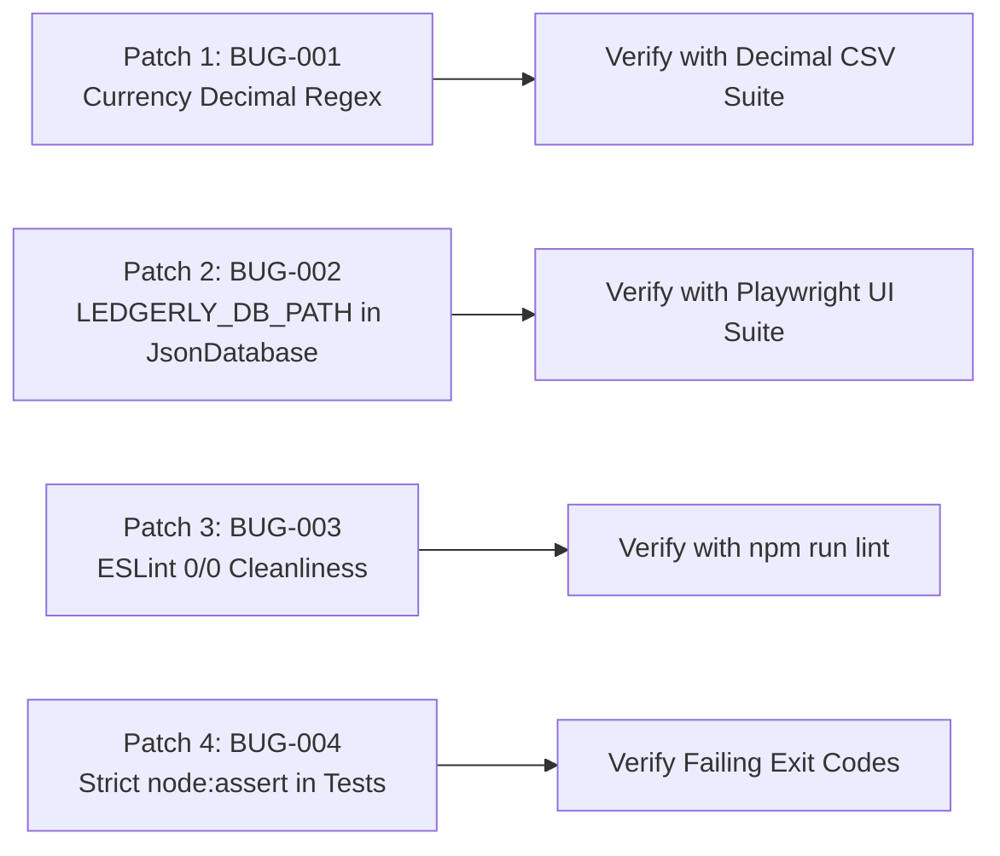

# 🔧 Tier 1: Immediate Critical Hotfixes Specification

> **Module**: Quality Assurance — Engineering Patch Specifications  
> **Document ID**: `IMP-001`  
> **Target Release**: `v0.4.4-patch1` / Pre-Phase 5 Gate  
> **Status**: APPROVED FOR IMPLEMENTATION  

---

## 1. Hotfix Overview

Before advancing to Phase 5 or cutting public release packages, the QA department requires immediate resolution of four identified defects.



---

## 2. Technical Patch Specifications

### Patch 1: Resolve BUG-001 (Statement Currency Decimal Stripping)
* **File**: `src/fileImporter.js`
* **Target Lines**: 177 and 251
* **Current Vulnerability**:
  ```javascript
  let amountStr = getVal(bestMapping.amountCol).replace(/[₹$Rs.INR,\s]/gi, '');
  ```
* **Corrective Patch**:
  ```javascript
  // Extract raw string
  const rawAmount = getVal(bestMapping.amountCol);
  // Strip currency symbols, country strings, and formatting commas without stripping decimal points
  const amountStr = rawAmount
    .replace(/[₹$€£,]/g, '')
    .replace(/\b(INR|USD|EUR|Rs\.?)\b/gi, '')
    .trim();
  let amount = parseFloat(amountStr);
  if (isNaN(amount)) continue;
  amount = Math.abs(parseFloat(amount.toFixed(2)));
  ```

---

### Patch 2: Resolve BUG-002 (Test Database Isolation)
* **File**: `src/services/JsonDatabase.js`
* **Target Lines**: 35–44
* **Current Vulnerability**:
  ```javascript
  constructor(customPath) {
    if (customPath) {
      this.filePath = customPath;
    } else {
      const userDataPath = app ? app.getPath('userData') : path.join(__dirname, '../../scratch');
      this.filePath = path.join(userDataPath, 'expenses_db.json');
    }
  ```
* **Corrective Patch**:
  ```javascript
  constructor(customPath) {
    const envOverride = process.env.LEDGERLY_DB_PATH;
    if (customPath) {
      this.filePath = customPath;
    } else if (envOverride) {
      this.filePath = envOverride;
    } else {
      const userDataPath = app ? app.getPath('userData') : path.join(__dirname, '../../scratch');
      this.filePath = path.join(userDataPath, 'expenses_db.json');
    }

    this.ensureStorageExists();
  }
  ```

---

### Patch 3: Resolve BUG-003 (ESLint Cleanliness)
* **File 1**: `src/nlpParser.js:L46`
  - Replace `let detectedCategory = null;` with `let detectedCategory;`.
  - Remove unused variable `amountTokenStr`.
* **File 2**: `src/quickPill.js:L1`
  - Add eslint environment / global declaration: `/* global hydrateIcons */`.
* **File 3**: `src/fileImporter.js:L395`
  - Remove unused variables `dateRegex` and `amountRegex`.
* **File 4**: `src/receiptStorage.js:L3`
  - Remove unused `app` import.

---

### Patch 4: Resolve BUG-004 (Strict Assertions in Test Suites)
* **File**: `scratch/test_phase5.js`
* **Patch**:
  ```javascript
  const assert = require('node:assert/strict');

  // Replace console.assert with strictAssert
  assert.strictEqual(csvResult.expenses[0].amount, 78.45, 'CSV parsed decimal amount must match 78.45');
  ```

---

## 3. Verification Criteria
* `npm run check` returns all clean.
* `npm run lint` returns 0 errors, 0 warnings.
* `node scratch/test_phase5.js` completes with 100% strict assertions passing.
* `npm run test:ui` executes against isolated test db without timing out.
