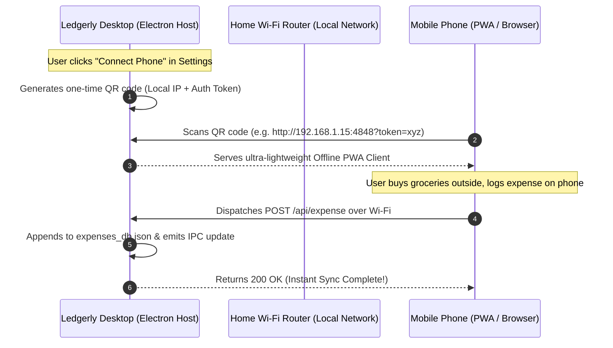

# 🌐 Tier 3: Strategic Roadmap & Local LAN Peer Sync

> **Module**: Quality Assurance — Architectural North Star  
> **Document ID**: `IMP-003`  
> **Target Release**: `v0.5.0` – `v1.0.0` Production  
> **Status**: CONCEPTUAL & ARCHITECTURAL PROPOSAL  

---

## 1. The Strategic Imperative: The Mobile Companion Bridge

The number one obstacle to Ledgerly's long-term user retention is the physical gap between where money is spent (outside on a smartphone) and where Ledgerly lives (at home/work on a desktop).

However, building a traditional cloud backend (AWS/Supabase) breaks Ledgerly's core privacy promise: **100% offline, zero cloud surveillance**.

### The Breakthrough Architecture: "Local LAN Peer Sync"
Instead of a cloud server, Ledgerly can run an embedded, ultra-lightweight HTTP/WebSocket server inside Electron when connected to home/office Wi-Fi.

### Why This Architecture Wins:
1. **Zero Cloud Infrastructure Costs**: No server hosting bills.
2. **100% Private**: Data never leaves the home network.
3. **Instant Mobile Logging**: Household members can log expenses from bed, the kitchen, or the sofa on their personal smartphones.
4. **Offline Queueing**: The phone's PWA caches expenses in IndexedDB when away from home, and automatically flushes them to the desktop as soon as it reconnects to home Wi-Fi.

---

## 2. Local Machine Receipt OCR Engine (Zero Cloud)

* **Target**: Automated receipt image parsing without sending photos to cloud vision APIs.
* **Technology**: Bundled WebAssembly Tesseract.js running in a headless background worker.
* **Flow**:
  1. User drops `receipt.jpg` into Ledgerly dropzone.
  2. OCR worker extracts text: merchant name, transaction date, and total line.
  3. Pre-populates the express form for single-click verification.

---

## 3. Transparent Database Vault Encryption (AES-256-GCM)

* **Target**: Physical device theft protection.
* **Technology**: Replace plain `expenses_db.json` with an encrypted vault stream derived from the PBKDF2 master password.
* **Result**: Even if an unauthorized person accesses the laptop hard drive, the database cannot be opened without the master password.
