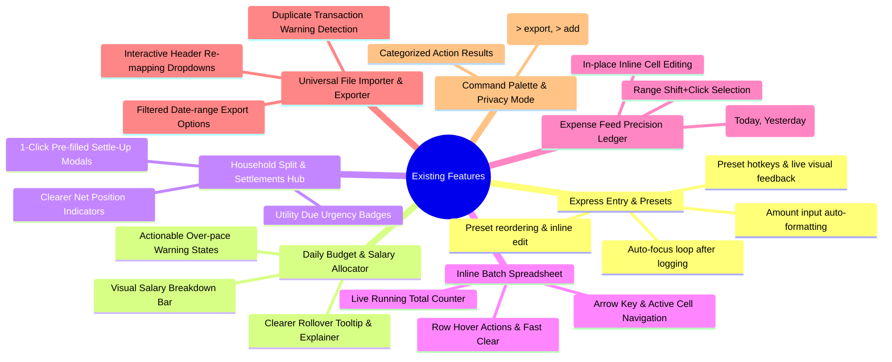

# 💎 Ledgerly: Elevating & Refining Existing Features

> **Focus**: Zero new feature bloat. Instead, systematically polish, streamline, and remove friction from the **core features already built into Ledgerly**.

---

## 🧭 Overview of Existing Core Features & Polish Areas



---

## ⚡ 1. Express Entry Bar & One-Click Presets

### 🔍 Current State & Friction Points
* After submitting an expense in the Express Bar, the user has to manually re-click or tab back to enter another item.
* Amount input allows raw unformatted text without currency styling.
* Clicking presets has no immediate tactile micro-animation to confirm the record was added.
* Editing an existing preset requires digging into configuration rather than quick in-place adjustment.

### 💡 How to Improve Existing Behavior

#### A. Continuous Rapid-Logging Loop (Auto-Refocus & Micro-Flash)
* Once you press <kbd>Enter</kbd> or click **"Quick Add"**:
  1. Instantly log the expense.
  2. Clear the title and amount inputs.
  3. **Auto-refocus the cursor back to the Title input** immediately.
  4. Trigger a brief **subtle emerald/amber flash** (`0.3s border glow`) around the express bar so the user knows it registered without looking down at the table.

```javascript
// In src/app.js (Inside express-form submit handler):
expressForm.addEventListener('submit', async (e) => {
  e.preventDefault();
  // ... existing expense saving logic ...
  
  // 1. Reset inputs
  expressTitle.value = '';
  expressAmount.value = '';
  
  // 2. Visual Success Pulse
  expressForm.classList.add('express-success-pulse');
  setTimeout(() => expressForm.classList.remove('express-success-pulse'), 350);
  
  // 3. Keep keyboard flow intact
  expressTitle.focus();
});
```

#### B. Preset Number Hotkeys (<kbd>Alt+1</kbd>, <kbd>Alt+2</kbd>...) & Tactile Ripple
* Add small subscript hotkey badges (`Alt+1`, `Alt+2`, `Alt+3`) on preset buttons.
* When clicked or triggered via keyboard, play a subtle scale-down ripple animation (`transform: scale(0.96)`).
* Allow **long-pressing or right-clicking any preset chip** to open a fast "Edit Preset Amount / Icon" mini-popover directly in place.

---

## 📊 2. Salary Allocator & Daily Budget Pacing Engine

### 🔍 Current State & Friction Points
* The Salary Allocator card shows numbers (`Income`, `Fixed Bills`, `Savings Goal`), but doesn't visually communicate the ratio.
* Users sometimes get confused about how **"Rollover Balance"** is calculated versus **"Safe Daily Limit"**.
* When over pace, the badge says "Over Pace" in red, but doesn't give clear, constructive feedback on how many days of moderation are needed to recover.

### 💡 How to Improve Existing Behavior

#### A. Visual Stacked Salary Allocation Bar
* In the Salary Modal and Expanded Sidebar, add a sleek 3-segment horizontal breakdown bar:
  $$\underbrace{\text{Fixed Bills (33\%)}}_{\text{Slate Blue}} \quad \vert \quad \underbrace{\text{Savings Goal (17\%)}}_{\text{Emerald Jade}} \quad \vert \quad \underbrace{\text{Discretionary Budget (50\%)}}_{\text{Spiced Chai Amber}}$$

```html
<div class="salary-breakdown-bar">
  <div class="bar-seg seg-fixed" style="width: 33.3%;" title="Fixed Bills: ₹20,000"></div>
  <div class="bar-seg seg-savings" style="width: 16.7%;" title="Savings: ₹10,000"></div>
  <div class="bar-seg seg-discretionary" style="width: 50.0%;" title="Discretionary: ₹30,000"></div>
</div>
```

#### B. Interactive Rollover Explainer Tooltip
* Hovering over the **Rollover Balance** or **Daily Budget Health** metric displays a plain-English calculation tooltip:
  > *"Based on Day 15 of 31: Allowed spend to date was ₹15,000. You have spent ₹13,400. You have **+₹1,600 rolled over** to spend safely across the remaining 16 days."*

#### C. Recovery Projection for Over-Pace State
* When over budget, instead of just displaying negative red text, show a recovery cue:
  > *"Pacing ₹450 over budget. Spending ₹40 less per day for the next 5 days will bring you back on track."*

---

## 👥 3. Household Splitting & Pairwise Debt Settlement Hub

### 🔍 Current State & Friction Points
* When clicking **"💳 Settle Up"** on a pairwise debt card (*"Priya owes Rahul ₹925.00"*), the modal opens with blank dropdowns requiring the user to manually re-select "Priya", "Rahul", and type "925.00".
* In the 3-Metric strip, it's not instantly clear whether a net balance of `₹925.00` means *you are owed money* or *you owe money*.
* Recurring utility bills have static display without visual urgency indicators for bills due today vs. next week.

### 💡 How to Improve Existing Behavior

#### A. 1-Click Pre-Populated Settlement Modal
* Clicking **"💳 Settle Up"** on any specific stream card automatically passes the parameters and pre-fills the modal:
  * **Payer (From)**: `Priya`
  * **Recipient (To)**: `Rahul`
  * **Amount**: `925.00`
  * **Date**: Today
  * **Note**: `Pairwise debt settlement`
* The user only needs to hit **"Record Settlement"** (1 click instead of 5 form interactions).

```javascript
// In src/app.js:
function openSettleModalWithData(fromMember, toMember, amount) {
  document.getElementById('settle-from-select').value = fromMember;
  document.getElementById('settle-to-select').value = toMember;
  document.getElementById('settle-amount-input').value = parseFloat(amount).toFixed(2);
  document.getElementById('settle-notes-input').value = `Settlement from ${fromMember} to ${toMember}`;
  document.getElementById('settle-modal').classList.add('active');
}
```

#### B. High-Clarity Net Position Badging
* Change raw balance text into explicit directional status pills:
  * Positive Balance: `🟢 YOU ARE OWED ₹925.00` *(You will receive money)*
  * Negative Balance: `🔴 YOU OWE ₹450.00` *(You need to pay)*
  * Zero Balance: `🔵 SETTLED & BALANCED (₹0.00)`

#### C. Urgent Countdown Status Colors on Recurring Utilities
* Due in > 5 days: Muted Blue badge (`Due in 8 days`)
* Due in 1–3 days: Spiced Chai Amber pulse (`⚡ Due in 2 days`)
* Due today / Overdue: Crimson alert (`⚠️ Due Today` / `Overdue by 1d`)

---

## 📋 4. Inline Spreadsheet Batch Entry Mode

### 🔍 Current State & Friction Points
* Navigating between cells relies strictly on <kbd>Tab</kbd>; arrow keys (<kbd>↑</kbd>, <kbd>↓</kbd>, <kbd>←</kbd>, <kbd>→ navigation</kbd>) do not move focus between table cells.
* There is no live running sum of the entered batch rows before committing them to the database.
* Clearing empty rows or deleting a specific typo row requires clicking small buttons.

### 💡 How to Improve Existing Behavior

#### A. Live Batch Total Footer Counter
* Place a sticky summary footer bar at the bottom of the batch table:
  $$\text{Total Rows: } \mathbf{6} \quad \vert \quad \text{Valid Entries: } \mathbf{5} \quad \vert \quad \text{Batch Total: } \mathbf{₹4,850.00}$$
* As the user types amounts in any row, the total updates in real-time.

```javascript
// In src/app.js:
function updateBatchRunningTotal() {
  const amountInputs = document.querySelectorAll('.batch-amount-input');
  let total = 0;
  let validCount = 0;
  amountInputs.forEach(input => {
    const val = parseFloat(input.value);
    if (!isNaN(val) && val > 0) {
      total += val;
      validCount++;
    }
  });
  document.getElementById('batch-live-total').textContent = `₹${total.toFixed(2)}`;
  document.getElementById('batch-live-count').textContent = `${validCount} valid entries`;
}
```

#### B. Excel-Like Arrow Key Cell Navigation
* Pressing <kbd>↓</kbd> in the Amount cell moves directly to the Amount cell in the row below.
* Pressing <kbd>Enter</kbd> on the last cell of the last row automatically creates a new row and focuses its Date cell.

---

## 💸 5. Dedicated Expense Feed & Precision Ledger

### 🔍 Current State & Friction Points
* Editing a typo in an expense requires clicking the pencil icon, waiting for the modal overlay to open, editing the field, and clicking Save.
* Bulk selecting rows requires clicking individual checkboxes one by one.
* The transaction feed is a flat list without visual date groupings.

### 💡 How to Improve Existing Behavior

#### A. In-Place Double-Click Inline Editing
* Double-clicking on any **Title**, **Amount**, or **Category** cell inside the table converts that cell into an inline input.
* Edit value $\rightarrow$ hit <kbd>Enter</kbd> $\rightarrow$ updates the database instantly without opening the modal.

#### B. Shift+Click Multi-Row Selection
* Check row #3, hold <kbd>Shift</kbd>, and check row #8: automatically checks all rows between #3 and #8.
* Speeds up bulk deletion or bulk CSV exporting significantly.

#### C. Sticky Date Grouping Headers
* Instead of repeating `2026-08-28` on every row, group transactions under elegant separator headers:
  * **📅 TODAY — August 29, 2026** *(3 transactions • ₹450.00)*
  * **📅 YESTERDAY — August 28, 2026** *(5 transactions • ₹1,820.00)*
  * **📅 EARLIER THIS WEEK**

---

## 📥 6. Universal File Importer & Exporter

### 🔍 Current State & Friction Points
* If the auto-importer guesses a column wrong (e.g. maps "Notes" to "Title"), the user has no way to fix it before importing.
* Re-importing a statement can accidentally create duplicate entries if the bank CSV contains previously logged dates.
* Exporting only exports the entire database without date or category filtering.

### 💡 How to Improve Existing Behavior

#### A. Interactive Column Re-Mapping Dropdowns in Preview
* In the import preview modal table header, render each column with an interactive mapping dropdown (`Date`, `Title`, `Amount`, `Category`, `Ignore`):
  * If the parser guessed wrong, the user changes the dropdown from "Notes" to "Description", and the preview table updates instantly.

#### B. Smart Duplicate Transaction Detection
* Compare imported rows against existing records in `expenses_db.json` matching the same `Date + Amount + Title`.
* Highlight potential duplicates with a subtle amber badge:
  `⚠️ Potential Duplicate (Already logged on 2026-08-20)` with a default uncheck toggle.

#### C. Filtered Export Dialog
* When clicking **"Export Excel"** or **"CSV"**, show a quick 2-option popover:
  * `[ Export This Month (42 records) ]`
  * `[ Export All Time (318 records) ]`

---

## 🔍 7. Command Palette (`Ctrl+K`) & Privacy Mode (`P`)

### 🔍 Current State & Friction Points
* Command Palette returns a flat search list without distinguishing between actions, navigation tabs, members, and transactions.
* Privacy Mode blurs numbers, but clicking the logo isn't obvious to new users unless they read the tooltip or press `P`.

### 💡 How to Improve Existing Behavior

#### A. Section-Categorized Command Palette
* Group search results under distinct section dividers:
  * **⚡ Quick Actions**: `Log New Expense`, `Add Recurring Bill`, `Export Excel`
  * **🧭 Workspaces**: `Go to Household Split`, `Go to Batch Entry`, `Go to Notes`
  * **👥 Household Members**: `Filter by Rahul`, `Filter by Priya`
  * **💸 Transactions**: Matching search queries

#### B. Clear Privacy Mode Visual Indicator
* When Privacy Mode is activated (<kbd>P</kbd>):
  * An animated padlock badge `🔒 PRIVACY ACTIVE` appears in the top titlebar.
  * Clicking it or pressing `P` smoothly unblurs the numbers with a 150ms CSS ease transition.

---

## 🎯 Summary Matrix: Friction Point vs. Refined Solution

| Existing Feature | Current Friction Point | Refined Frictionless UX |
|---|---|---|
| **Express Entry** | Lost focus after logging | Continuous auto-focus loop + micro green pulse |
| **Presets** | No click feedback / hard to edit | Number badges (<kbd>Alt+1</kbd>) + right-click in-place edit |
| **Salary Budget** | Numbers without visual ratios | 3-segment stacked color bar + plain-English rollover tooltip |
| **Household Split** | Settle-up modal opens blank | 1-click pre-filled modal directly from pairwise cards |
| **Batch Entry** | No running total before save | Sticky live running sum footer (`5 rows • ₹4,850.00`) |
| **Expense Feed** | Full modal required to fix typos | Double-click inline cell editing + Shift+Click range select |
| **File Importer** | Rigid auto-mapping & duplicate risk | Interactive column headers + duplicate warning badges |
| **Command Palette** | Flat unorganized search results | Categorized sections (Actions, Navigation, Transactions) |
